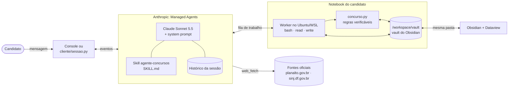
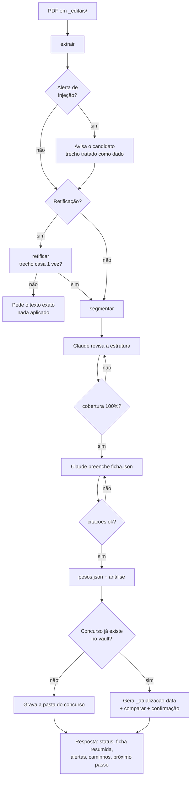
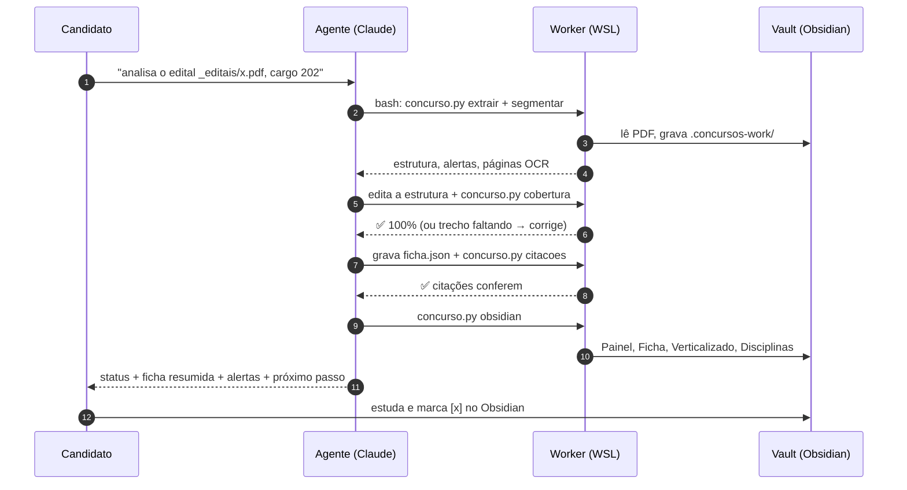

# Agente de Estudos para Concursos

Agente de IA construído no **Claude Console (Managed Agents)**. Ele lê o edital de um concurso público, monta o plano de estudos no **Obsidian** e garante, por código, que nenhuma linha do conteúdo programático se perde no caminho.

| | |
|---|---|
| **Disciplina** | Tendências em Ciência da Computação (Engenharia de Prompt e Aplicações em IA) |
| **Unidade** | IV, Agentes e Ética: projeto prático |
| **Instituição** | UDF, Ciência da Computação, 2026/2 |
| **Dados de teste** | Editais fictícios, gerados pelo próprio projeto, e dois editais reais na validação em campo (DATAPREV 2026 e SEDES-DF 2026, não versionados) |

## Onde o projeto está

| Componente | Estado | Comprovação |
|---|---|---|
| Núcleo determinístico (`concurso.py`): extração, segmentação, cobertura, citações, retificação e exportações | ✅ Testado | 39/39 testes passando ([log](docs/resultados/testes.log)) |
| Demonstração ponta a ponta, sem IA | ✅ Executada | [log](docs/resultados/demo.log) |
| Teste de mutação | ✅ Executado | 7/7 defeitos detectados ([log](docs/resultados/mutacao.log)) |
| Agente no Console (system prompt, skill, ambiente) | ✅ 5 sessões reais | Edital fictício, dois editais reais (DATAPREV 2026 e SEDES-DF 2026, cerca de US$ 1,50 cada) e um PDF escaneado: cobertura 100% e citações conferidas em todos ([detalhes](docs/validacao-em-campo.md#94-sessão-com-edital-real-dataprev-2026)) |
| Worker self-hosted no WSL | ✅ Validado | Ubuntu 26.04: vault montado, C: fora do alcance do agente, worker conectado |
| Segurança do vault (mitigações M1–M4) | ✅ Validada em campo | Ataque controlado com 5 de 5 verificações aprovadas, e Painel funcionando com o JavaScript do Dataview desligado ([detalhes](docs/validacao-em-campo.md#126-mitigação-m4-painel-sem-javascript)) |
| Painel do Obsidian (Dataview) | ✅ Validado no app | Obsidian 1.15.1 + Dataview 0.5.68: 8 verificações do Painel antigo e 5 do Painel sem JavaScript, com capturas ([detalhes](docs/validacao.md#validação-no-obsidian-23112026)) |

---

## Sumário

1. [Introdução](#1-introdução)
2. [O problema](#2-o-problema)
3. [Objetivos](#3-objetivos)
4. [Tecnologias e justificativas](#4-tecnologias-e-justificativas)
5. [Prompt direto × agente](#5-prompt-direto--agente)
6. [Arquitetura](#6-arquitetura)
7. [Camadas do agente](#7-camadas-do-agente)
8. [Fluxo de execução](#8-fluxo-de-execução)
9. [Engenharia de prompt](#9-engenharia-de-prompt)
10. [Memória e contexto](#10-memória-e-contexto)
11. [Privacidade, segurança e LGPD](#11-privacidade-segurança-e-lgpd)
12. [Vieses e como foram tratados](#12-vieses-e-como-foram-tratados)
13. [Supervisão humana e transparência](#13-supervisão-humana-e-transparência)
14. [Validação](#14-validação)
15. [Vantagens e limitações](#15-vantagens-e-limitações)
16. [Próximos passos](#16-próximos-passos)
17. [Como instalar e executar](#17-como-instalar-e-executar)
18. [Referências](#18-referências)

Organização do repositório:

```text
AgenteConcursos/
├── agente/                          ← o que é configurado no Claude Console
│   ├── system-prompt.md             ·  system prompt em 8 partes
│   ├── agent.md                     ·  definição do agente (formato ant apply)
│   ├── environment.yaml             ·  ambiente self-hosted
│   ├── api/                         ·  JSON para criar ambiente, agente e sessão pela API
│   └── skills/agente-concursos/
│       ├── SKILL.md                 ·  procedimento dos módulos M1–M8
│       └── scripts/concurso.py      ·  núcleo determinístico (CLI, 9 subcomandos)
├── worker/setup-wsl.sh              ← prepara o Ubuntu/WSL como worker isolado (cria gravar-chave.sh e iniciar-worker.sh)
├── cliente/sessao.py                ← chat pelo terminal com teto de gasto
├── vault-modelo/_perfil-estudos.md  ← perfil lido no início de cada sessão
├── demo/                            ← editais fictícios + execução sem IA
├── tests/                           ← 33 casos + teste de mutação
├── docs/                            ← instalação, engenharia de prompt, validação, validação em campo, logs
└── apresentacao/                    ← slides (Marp) e roteiro
```

---

## 1. Introdução

Todo estudo para concurso começa no edital. É dele que saem as disciplinas cobradas, o peso de cada prova, a regra de penalização, a nota mínima e, sobretudo, a lista exata de tópicos. Os candidatos costumam transformar essa lista num checklist chamado **edital verticalizado**: uma linha por tópico, marcada conforme o estudo avança.

Fazer isso à mão leva horas, e pular um tópico significa estudar o edital errado. Pedir a um chatbot é rápido, mas modelos de linguagem tendem a **resumir** listas longas ("… e demais tópicos"), **misturar** regras de bancas diferentes e **inventar** detalhes plausíveis. Em concurso, cada um desses erros custa pontos.

Este projeto resolve o problema com um **agente**. O Claude interpreta, organiza e escreve. Um script determinístico confere cada resultado antes de ele chegar ao candidato. Tudo é gravado no vault do Obsidian, que vira a base de estudo: checklist, painel de prioridade, anotações, questões, caderno de erros e revisão espaçada.

## 2. O problema

- **Editais são longos e densos.** A informação que define a estratégia (penalização, mínimos por prova, cláusula de barreira, data de corte da legislação) fica espalhada em itens distantes.
- **Verticalizar à mão é lento e falha.** Um tópico pulado só é descoberto na prova.
- **LLM sem controle não é confiável para isso.** Não há garantia de que a saída contém todo o texto, nem de que um valor citado está no edital.
- **Retificações mudam o edital** depois que o estudo já começou. Descobrir o que mudou exige comparar versões linha a linha.
- **O material fica disperso.** Anotações, erros e revisões ficam em lugares diferentes, sem uma visão de prioridade baseada no peso real de cada disciplina.
- **O edital é conteúdo de terceiros.** Um PDF pode conter texto que tenta manipular um agente de IA (*prompt injection*).

## 3. Objetivos

**Objetivo geral:** construir um agente de IA que transforme editais de concursos públicos em material de estudo confiável no Obsidian, com fidelidade total ao conteúdo programático garantida por verificação automática.

**Objetivos específicos:**

1. Extrair o texto do PDF (com OCR quando preciso) e separar corpo, conteúdo programático e anexos.
2. Gerar o edital verticalizado com o **texto literal** e provar, por comparação palavra a palavra, que nada foi omitido, alterado ou inventado.
3. Gerar uma ficha do concurso em que **cada campo cita o item e o trecho** do edital, validada por código.
4. Calcular a prioridade de estudo e o ciclo semanal a partir do peso real de cada disciplina.
5. Aplicar retificações de forma rastreável e mostrar o que mudou antes de alterar as notas.
6. Gravar tudo no vault do Obsidian **sem nunca sobrescrever o progresso** já marcado.
7. Detectar e sinalizar tentativas de manipulação das instruções vindas de PDFs.
8. Medir a confiabilidade do próprio pipeline: testes automatizados que rodam sem conta nem internet, e teste de mutação para provar que esses testes pegam defeitos.

## 4. Tecnologias e justificativas

| Ferramenta | Papel |
|---|---|
| **Claude Console · Managed Agents** (beta) | Hospeda o agente: modelo, system prompt, ferramentas, skill e sessões com histórico |
| **Claude Sonnet 5.5** | Modelo do agente: interpreta o edital, preenche a ficha e escreve anotações e questões |
| **Agent Skills** | Pacote `agente-concursos`: o procedimento (SKILL.md) e o script, carregados sob demanda |
| **Python 3** (PyMuPDF, pdfplumber, Tesseract OCR, openpyxl) | Núcleo determinístico: extração, segmentação, cobertura, citações e exportação |
| **Ubuntu no WSL2** + `ant` CLI | Worker self-hosted: executa as ferramentas do agente no notebook, com acesso só ao vault |
| **Obsidian** + plugin **Dataview** | Base de estudo: checklist por disciplina, painel de prioridade, revisões vencidas, erros |
| **Anki** (opcional) | Revisão espaçada dos flashcards exportados |
| **GitHub** | Código, documentação e evidências |

**Por que Managed Agents e não uma chamada simples à API?** O agente precisa de várias etapas com ferramentas (rodar o script, ler o resultado, corrigir, rodar de novo). O Managed Agents entrega esse laço pronto, com sessões que guardam o histórico e suporte nativo a skills.

**Por que um worker no notebook e não o sandbox na nuvem?** O estado do estudo (tópicos marcados, anotações, erros) vive no Obsidian. Com o worker local, o agente lê e grava o vault real. Não há upload, download nem duas cópias divergentes do mesmo estado.

**Por que um script em vez de confiar no modelo?** "Não perder conteúdo" é uma propriedade que se **verifica**, não que se pede. Um diff palavra a palavra prova o resultado. Uma instrução no prompt só aumenta a chance de ele estar certo.

## 5. Prompt direto × agente

| Aspecto | "Cole o edital no chat e peça um resumo" | Agente de Concursos |
|---|---|---|
| Fidelidade do conteúdo programático | Sem garantia. Listas longas costumam ser resumidas | Texto literal + `cobertura` palavra a palavra nos dois sentidos |
| Origem de cada informação | Não informada | Item e página do edital em cada campo da ficha |
| Regras da banca | Podem vir da "memória" do modelo | Só do edital. O que não consta vira "NÃO CONSTA" |
| Retificação | Refazer tudo e torcer | Aplicação rastreável + lista de mudanças antes de editar |
| Progresso do estudo | Fica fora da conversa | Checklist no Obsidian, preservado nas atualizações |
| Prioridade | Opinião do modelo | Fórmula explícita sobre o peso real (pontos × incidência × domínio) |
| PDF com instruções maliciosas | Pode obedecer | Detectado, sinalizado e tratado como dado |
| Reprodutibilidade | Cada execução dá um texto diferente | Mesma entrada, mesmos arquivos (CEN-10) |

## 6. Arquitetura



Princípios de projeto:

- **O modelo interpreta, o código confere.** Toda saída que importa passa por uma checagem automática que o modelo não consegue contornar: cobertura, citações, numeração e proteção do progresso.
- **Uma fonte da verdade.** O vault é o estado. O agente não guarda cópias paralelas do progresso.
- **Nada some sem pedido.** O script não sobrescreve notas existentes. Apagar exige confirmação explícita.
- **Menor alcance possível.** O worker só enxerga `/workspace`. O `C:` e a execução de programas do Windows ficam desligados no WSL. A chave de API fica no Windows, fora do alcance do agente.

## 7. Camadas do agente

### Camada 1: Perceptiva (`extrair`, `retificar`, `segmentar`)
- Lê o PDF página a página. Usa OCR quando a página não tem texto e lista essas páginas para conferência.
- Remove cabeçalhos e rodapés repetidos e registra o que removeu em `meta.json`.
- Normaliza artefatos tipográficos (ligaduras como "fi", hífen invisível), sem alterar o conteúdo.
- **Detecta prompt injection**: trechos que parecem ordens dirigidas a uma IA (ignorar instruções, troca de papel, comandos de terminal, pedido de credenciais). Só sinaliza e nunca remove texto.
- Aplica retificações (onde se lê / leia-se) somente quando o trecho casa exatamente uma vez.
- Separa o corpo (itens numerados e anexos) do conteúdo programático (grupos, disciplinas e tópicos).
- Lê o perfil do candidato (`_perfil-estudos.md`) e o que já existe no vault.

### Camada 2: Cognitiva (Claude + skill)
- Revisa a estrutura do verticalizado (agrupamentos, observações, níveis) sem tocar no texto.
- Preenche `ficha.json` copiando o trecho literal que comprova cada campo.
- Estima `pesos.json` quando o edital só informa itens por prova, marcando a estimativa.
- Escreve a análise estratégica, as anotações (lei seca de fonte oficial), as questões no formato da banca e a classificação dos erros.

### Camada 3: Decisória (regras verificáveis)
| Regra | Implementação | Efeito |
|---|---|---|
| Nada perdido, nada inventado | `cobertura`: diff palavra a palavra nos dois sentidos, com pareamento 1:1 de blocos movidos | Reprovado → o agente corrige a estrutura e roda de novo |
| Citação comprovada | `citacoes`: item existe, trecho literal, números do valor presentes no trecho | Reprovado → o campo não entra na ficha |
| Numeração plausível | Um tópico só é reconhecido se seguir a sequência (1 → 1.1 → 2…) | "art. 5" e "Windows 10" não viram tópicos |
| Prioridade | `pontos × incidência × (1 − domínio/5)`, com incidência neutra = 1 sem dado real | Ordena disciplinas e distribui as horas do ciclo |
| Progresso protegido | Pasta existente → nova versão em `_atualizacao-<data>/` | Nenhum `[x]` marcado é perdido |

### Camada 4: Executiva (`obsidian`, `xlsx`, `anki`, `comparar`)
- Grava no vault: Painel (consultas do Dataview, sem JavaScript), Ficha, Edital Verticalizado (embeds), Edital Integral (âncora por item), uma nota por disciplina com checklist literal, além de templates de anotação e de erro.
- Exporta a planilha (opcional) e os flashcards para o Anki.
- `comparar` lista tópicos incluídos, removidos e alterados entre duas versões.
- **Limites:** opera só dentro de `/workspace`, nunca apaga arquivos e só usa `--forcar` (sobrescrever) com pedido explícito.

## 8. Fluxo de execução



Sequência de uma análise de edital:



## 9. Engenharia de prompt

Detalhes completos em [docs/engenharia-de-prompt.md](docs/engenharia-de-prompt.md). O comportamento vem de três camadas de instrução:

| Camada | Quando entra no contexto | Papel |
|---|---|---|
| System prompt (`agente/system-prompt.md`) | Em toda sessão | Identidade, limites, segurança, formato |
| Skill (`SKILL.md`) | Nome e descrição sempre. Corpo só quando a tarefa é de concurso | Procedimento de cada módulo e contratos de dados |
| Script (`concurso.py`) | Nunca: é executado, não lido | As regras que precisam ser garantidas |

O system prompt segue oito partes:

| Parte | Neste agente |
|---|---|
| Papel | Agente de estudos de um único candidato, dentro do vault dele |
| Objetivo | Edital → material confiável gravado no Obsidian |
| Contexto | Caminhos do vault, da skill, dos PDFs e do perfil |
| Dados permitidos | Edital, retificações, legislação oficial, vault. **Listas de candidatos ficam fora** |
| Regras de decisão | Texto literal, cobertura e citações obrigatórias, fato × inferência, fórmula de prioridade |
| Restrições de segurança | Conteúdo externo é dado, nada é apagado sem confirmação, nenhuma credencial, nenhuma lei inventada |
| Formato | Status, resultado em tabela, caminhos, um próximo passo |
| Tratamento de erros | OCR, programático não encontrado, retificação que não casa, dependência ausente |

Técnicas aplicadas:
- **Validação externa no lugar de autoavaliação.** O modelo roda `cobertura` e `citacoes` e corrige até passar. Ele não "confere a si mesmo".
- **Contratos de saída em JSON** (`ficha.json`, `pesos.json`, `retificacoes.json`) com regras de validação conhecidas pelo modelo e pelo script.
- **Separação instrução × dado.** PDFs, páginas e buscas são dados por definição, com a detecção de injeção como segunda barreira.
- **Proveniência e incerteza explícitas.** Item e página em cada afirmação, "NÃO CONSTA" quando falta informação, nível de confiança nas inferências e asterisco nas estimativas.
- **Divulgação progressiva.** Só o necessário entra no contexto, o que reduz custo e ruído.
- **Roteamento por intenção.** Uma tabela mapeia cada tipo de pedido aos módulos (M1–M8), para não rodar o pipeline inteiro sem necessidade.

## 10. Memória e contexto

| Tipo | Onde fica | Conteúdo | Duração |
|---|---|---|---|
| **Contexto da sessão** | Managed Agents (Anthropic) | Conversa e resultados das ferramentas. O serviço aplica cache de prompt e compactação | Enquanto a sessão existir (pode ser apagada) |
| **Estado de estudo** | Vault: `Concursos/<concurso>/` | Checklists `[x]`, domínio por disciplina, anotações, questões, erros, datas de revisão | Permanente, sob controle do candidato |
| **Trabalho intermediário** | Vault: `.concursos-work/<slug>/` (pasta oculta) | Texto extraído, itens, verticalizado, ficha, pesos | Permite retomar (retificação, novas anotações) em outra sessão |
| **Registros de auditoria** | `.concursos-work/<slug>/` | `cobertura.md`, `citacoes.md`, `retificacoes_log.md`, `meta.json` (alertas, OCR, cabeçalhos removidos) | Junto do concurso |
| **Perfil** | `_perfil-estudos.md` | Horas por semana, alvos, domínio declarado | Editado pelo candidato |

**Por que não usar *memory stores* do Managed Agents?** Porque o vault já é persistente, visível e editável pelo candidato. Uma segunda memória criaria duas versões do mesmo estado, e cedo ou tarde elas divergiriam. A revisão espaçada também usa o vault: o Painel calcula a próxima revisão (1, 7, 30, 60 e 120 dias) a partir de `ultima_revisao` e `n_revisoes` de cada anotação.

## 11. Privacidade, segurança e LGPD

| Princípio da LGPD (art. 6º) | Aplicação no agente |
|---|---|
| Finalidade | Os dados servem só para organizar o estudo do próprio titular |
| Adequação e necessidade | O perfil pede só rotina, alvos e domínio. O agente não lê nada fora de `/workspace` |
| Livre acesso e qualidade | Todo o estado fica em Markdown no computador do candidato, legível e editável por ele |
| Transparência | Cada campo da ficha mostra item e página. Os relatórios de cobertura e de citações ficam no vault |
| Segurança | WSL sem o `C:` e sem interop. Chave de API só no Windows. Chave do worker com `chmod 600`. `.gitignore` bloqueia credenciais |
| Prevenção | Detecção de injeção, nenhuma credencial lida ou enviada, teto de gasto por sessão |
| Não discriminação | A prioridade usa só dados do edital e o domínio declarado (seção 12) |
| Responsabilização | Registros de auditoria por concurso. Testes e teste de mutação documentados |

Outros cuidados:
- **Dados de terceiros:** editais de resultado trazem nome e inscrição de outros candidatos. O agente é instruído a **não processar** essas listas e a usar só números agregados (nota de corte, quantidade de aprovados).
- **O que vai para a Anthropic:** a conversa, os resultados das ferramentas e a skill. Os arquivos do vault ficam no notebook, mas o trecho que uma ferramenta lê e devolve ao modelo vai junto com a conversa. As sessões do Managed Agents ficam guardadas até serem apagadas, e o recurso não é elegível a retenção zero de dados. Por isso o perfil não deve conter dados sensíveis (saúde, documentos), e sessões antigas podem ser apagadas pelo Console ou pela API.
- **Repositório:** nenhum edital, vault ou credencial real é versionado. A demonstração usa só editais fictícios.

## 12. Vieses e como foram tratados

**Riscos considerados:**
1. **Estereótipo de banca:** o modelo pode generalizar "como a banca X cobra" a partir da memória de treino e transferir padrões de uma banca para outra.
2. **Distribuição estimada:** quando o edital só informa itens por prova, dividir pelo número de tópicos pode supervalorizar disciplinas com listas longas.
3. **Questões geradas:** tendem a cobrar o que é fácil de transformar em pergunta (prazos, números) e deixar de lado a interpretação.
4. **Posição doutrinária:** em temas jurídicos controversos, o modelo pode apresentar uma corrente como se fosse consenso.
5. **Qualidade desigual da entrada:** editais escaneados, mais comuns em órgãos menores, passam por OCR e têm mais erros. Isso piora o resultado justamente para quem tem menos estrutura.

**Mitigações implementadas:**
1. Regras da banca **só do edital**. Padrões de cobrança aparecem rotulados como padrão geral, com confiança média.
2. Estimativas marcadas (`estimado: true` e coluna "Estimado" no Painel) e incidência neutra (1) até haver dado real de provas anteriores.
3. Questões rotuladas como inéditas, que servem para fixar e não para calibrar nota, direcionadas aos tópicos de maior peso por tópico.
4. Lei seca só de fonte oficial. Jurisprudência só com número e tribunal, ou é omitida.
5. Páginas lidas por OCR listadas para conferência humana.
6. **Consistência verificada:** o mesmo edital gera os mesmos arquivos (CEN-10). A fórmula de prioridade é pública, documentada e igual para qualquer candidato.

**Limite conhecido:** o texto escrito pelo modelo (anotações, questões, análise) varia entre execuções. A estrutura e as citações são garantidas por código, mas o conteúdo explicativo depende de revisão do candidato.

## 13. Supervisão humana e transparência

**Quando o agente para e devolve a decisão ao candidato:**

| Situação | Comportamento |
|---|---|
| Retificação publicada | Mostra a lista de mudanças (`comparar`) e só edita as notas depois da confirmação |
| Concurso já existe no vault | Gera `_atualizacao-<data>/`. O progresso não é tocado |
| Retificação que não casa com o edital | Não aplica. Pede o texto exato |
| Páginas lidas por OCR | Lista as páginas para conferência |
| Tabelas do PDF (vagas, cronograma) | Avisa para conferir com o PDF antes de usar qualquer número |
| Lei inacessível | Escreve [CONFERIR NA FONTE] em vez de reconstruir o artigo |
| Texto suspeito de manipulação no PDF | Mostra página e trecho e não obedece |
| Pedido para apagar arquivos | Exige confirmação explícita |

**Transparência:**
- A ficha liga cada campo ao item do edital (`[[03 Edital Integral#^i-5-4|item 5.4]]`) e guarda os trechos literais usados.
- O relatório de cobertura fica dentro da pasta do concurso (`99 Relatório de Cobertura.md`).
- O Painel mostra a fórmula de prioridade e marca as estimativas.

**Limites de permissão:** o worker roda no WSL sem acesso ao `C:` nem a executáveis do Windows. O agente só trabalha em `/workspace`, e cada sessão tem teto de gasto (`cliente/sessao.py`, US$ 3 por padrão).

**Responsabilidade final:** o agente organiza e confere. A inscrição, os prazos e a decisão de estudar ou não um tópico continuam sendo do candidato, que deve consultar o edital oficial publicado pelo órgão.

## 14. Validação

Comando: `python -m unittest discover -s tests -v`. Log em [docs/resultados/testes.log](docs/resultados/testes.log). Detalhamento de cada caso em [docs/validacao.md](docs/validacao.md).

| Caso | Situação simulada | Comportamento verificado |
|---|---|---|
| CEN-01 | Edital numerado | ✅ 5 disciplinas, subtópicos no nível certo, cobertura 100% |
| CEN-02 | Edital sem numeração e com anexos | ✅ 9 + 5 tópicos, anexos preservados, cobertura 100% |
| CEN-03 | Dados incompletos (sem conteúdo programático) | ✅ Para com orientação. Nada é gerado |
| CEN-04 | IA omite um subtópico | ✅ Reprovado, com o trecho faltante |
| CEN-05 | IA inventa, resume ou duplica | ✅ Os três reprovados |
| CEN-06 | Citação inválida na ficha | ✅ Valor divergente, item inexistente e paráfrase reprovados |
| CEN-07 | Retificação | ✅ Aplicada uma vez (idempotente). Trecho inexistente recusado |
| CEN-08 | Prompt injection no PDF | ✅ 2 alertas na página certa. Texto preservado como dado |
| CEN-09 | Reexportação com progresso marcado | ✅ Nenhum `[x]` perdido |
| CEN-10 | Mesma entrada, mesma saída | ✅ Arquivos idênticos byte a byte |
| CEN-11 | Injeção que pede código no Obsidian, sem as palavras clássicas | ✅ Sinalizada na página certa. A versão anterior não pegava |

Além desses onze, 28 casos cobrem as regras de cada camada (REG-01 a REG-21) e a configuração e segurança (SEG-01 a SEG-07). Os casos REG-16 a REG-20 reproduzem padrões encontrados em editais reais: quadro de vagas numerado, assinatura solta no fim, ruído de OCR, a palavra "Powershell" no conteúdo e cabeçalho numerado com dois-pontos. O REG-21 confere que o Painel padrão não tem JavaScript. **39/39 passando.**

**Teste de mutação:** cada proteção foi desligada, uma por vez, numa cópia do script. A suíte detectou **7 de 7 defeitos**. Na primeira rodada, a quebra da regra de numeração passou despercebida, o que levou à criação do caso REG-03.

**Defeito real encontrado:** a primeira execução da demonstração reprovou duas citações corretas, porque o PDF usava a ligadura tipográfica "fi". O problema foi corrigido e agora é coberto pelo caso REG-05.

**Validado no Obsidian** (23/11/2026): Painel, embeds do verticalizado, marcação refletida no Painel e links da Ficha para o Edital Integral. Capturas em [docs/resultados/obsidian](docs/resultados/obsidian). O Painel sem JavaScript foi validado com *Enable JavaScript Queries* desligado: tudo renderiza, e um bloco `dataviewjs` não roda.

**Sessões reais** (23/11/2026): o agente rodou no Console com o worker no WSL.

| Sessão | Resultado | Custo |
|---|---|---|
| Edital fictício, 4 páginas | Cobertura 100%, 27 citações conferidas, pasta da demonstração intacta, em 1 min 42 s | US$ 0,27 |
| Ataque controlado | 5 de 5: recusou código no vault, sem `sudo`, não obedeceu à injeção | US$ 0,08 |
| Edital real DATAPREV 2026, 64 páginas | Cobertura 100% (20.430 palavras do corpo), 68 citações conferidas, auditoria limpa, 11 de 11 regras e contas conferidas contra o PDF, em 8 min 3 s | US$ 1,49 |
| Edital real SEDES-DF 2026, 59 páginas | Cobertura 100% (44.318 palavras do corpo), 91 citações conferidas, 12 de 12 regras e contas conferidas, incluindo a fórmula da discursiva e a cláusula de barreira, em 7 min 20 s | US$ 1,47 |
| PDF escaneado, 4 páginas | Lido por OCR, cobertura 100%, e os 3 erros de leitura reais apontados para conferência | US$ 0,08 |

A validação revelou 11 defeitos, todos corrigidos e cobertos por teste:

- **Instalação e segurança (5):** formatação da Ficha, gravação da chave do worker, detector de chaves, injeção que pede código no Obsidian e reexecução do setup.
- **Editais reais e OCR (5):** quadro de vagas numerado, assinatura descartada, falso alerta em "Powershell", cabeçalho com dois-pontos e ruído de OCR.
- **Workers em paralelo (1):** dois workers rodando ao mesmo tempo apagavam a skill um do outro. Agora o script do worker recusa uma segunda janela.

Em todas as sessões, o que o código atesta bateu. Os erros ficaram no texto livre dos resumos: contagens de citações e uma lista de retificações incompleta. Também confirmou 1 risco de segurança (nota com `dataviewjs` roda no Windows), mitigado em quatro camadas. Relatório completo: **[docs/validacao-em-campo.md](docs/validacao-em-campo.md)**. Os passos para rodar os testes manuais estão em [docs/instalacao.md](docs/instalacao.md) (I1–I8).

## 15. Vantagens e limitações

**Vantagens**
1. **Fidelidade comprovável:** o candidato não precisa confiar no modelo. A cobertura prova que o verticalizado tem todo o texto do edital, e as citações provam de onde veio cada dado da ficha.
2. **Estudo num lugar só:** checklist, prioridade, anotações, questões, erros e revisões vivem no mesmo vault, atualizados pelo agente e pelo candidato.
3. **Custo baixo e previsível:** a parte pesada roda no script, sem tokens. Pela tabela de preços (Sonnet 5.5 a US$ 2/US$ 10 por milhão de tokens, sessão a US$ 0,08 por hora ativa), a estimativa é da ordem de US$ 1 por edital, com teto por sessão. Medido na validação em campo: US$ 0,27 para o edital fictício de 4 páginas, e US$ 1,49 e US$ 1,47 para os editais reais de 64 e 59 páginas.

**Limitações**
1. **Validação em poucos cenários:** a integração rodou num notebook, com um edital fictício, dois reais e um PDF escaneado. Managed Agents está em beta, e duas bancas (FGV e Quadrix) não representam todas.
2. **Tabelas e PDFs escaneados:** quadros de vagas e de cronograma quebram na extração, e o OCR erra caracteres. Os dois exigem conferência humana.
3. **Heurísticas:** a detecção de injeção e o reconhecimento de cabeçalhos usam padrões. Casos atípicos podem passar ou gerar falso positivo. A cobertura garante o texto, não a hierarquia.
4. **O vault é uma ponte para o Windows (risco confirmado):** com o Dataview executando JavaScript, uma nota com bloco `dataviewjs` roda no Windows com acesso ao Node, fora do isolamento do WSL. Se uma injeção escapar da heurística e o agente obedecer, o código roda quando o candidato abrir a nota. Quatro mitigações foram implementadas e validadas: regra no system prompt, `.obsidian` somente leitura para o agente, o subcomando `auditar` e um Painel sem JavaScript, que permite desligar o *Enable JavaScript Queries*. Quem religar essa opção volta a depender só das três primeiras. Detalhes em [docs/validacao-em-campo.md](docs/validacao-em-campo.md#124-opções-de-mitigação-para-o-r2).

## 16. Próximos passos

- Importar estatísticas reais de incidência por tópico (exportações de plataformas de questões) para substituir a incidência neutra.
- Extração de tabelas com validação cruzada (dois extratores e comparação).
- Avaliação automatizada da Camada 2 (*evals*): editais de referência com fichas esperadas, para medir a precisão do modelo a cada mudança no prompt.
- Agendamento (*scheduled deployments*) para verificar retificações publicadas toda semana.
- Suporte a editais em HTML (diários oficiais).
- Subagente dedicado a questões, com revisão cruzada do gabarito.
- Trazer de volta ao Painel sem JavaScript as colunas "% da nota" e "h/semana", que dependem da soma de todas as linhas.
- Aplicar e testar retificações reais (as três da SEDES-DF) com o subcomando `comparar`.
- Isolar a chave do ambiente das ferramentas do agente. Um usuário Linux dedicado não resolve, porque as ferramentas rodam como filhas do worker. Exigiria que o próprio worker separasse os processos.

## 17. Como instalar e executar

Guia detalhado: **[docs/instalacao.md](docs/instalacao.md)**. Versão curta:

1. Criar a chave de API no Console ("Em outro lugar") e enviar a skill (`agente/skills/agente-concursos`) pela API de Skills.
2. Criar o ambiente **self-hosted** e o agente pela API, com os modelos de `agente/api/`.
3. Instalar o Ubuntu no WSL, rodar `worker/setup-wsl.sh` com o caminho do vault, gerar a chave do ambiente no Console e gravá-la com `~/gravar-chave.sh`. Depois, `~/iniciar-worker.sh`.
4. No Obsidian, ativar o Dataview com **Enable JavaScript Queries desligado** e copiar `vault-modelo/_perfil-estudos.md`.
5. Conversar pelo Console, pela API (`agente/api/sessao.json`) ou por `cliente/sessao.py`.

Esse caminho foi executado de ponta a ponta em 23/11/2026. O relatório completo, com comandos, saídas, capturas, problemas e custos, está em **[docs/validacao-em-campo.md](docs/validacao-em-campo.md)**.

Rodar a validação no próprio computador (sem conta):

```bash
pip install -r requirements.txt
python -m unittest discover -s tests -v
python demo/demo.py
python tests/mutacao.py
```

## 18. Referências

ANTHROPIC. **Building effective agents**. 2024. Disponível em: https://www.anthropic.com/research/building-effective-agents. Acesso em: 23 nov. 2026.

ANTHROPIC. **Claude Managed Agents**: documentação. Disponível em: https://platform.claude.com/docs/en/managed-agents/overview. Acesso em: 23 nov. 2026.

ANTHROPIC. **Agent Skills**: documentação. Disponível em: https://platform.claude.com/docs/en/agents-and-tools/agent-skills/overview. Acesso em: 23 nov. 2026.

BRASIL. **Lei nº 13.709, de 14 de agosto de 2018**. Lei Geral de Proteção de Dados Pessoais (LGPD). Brasília, DF: Presidência da República, 2018. Disponível em: https://www.planalto.gov.br/ccivil_03/_ato2015-2018/2018/lei/l13709.htm. Acesso em: 23 nov. 2026.

CEPEDA, N. J. *et al*. Distributed practice in verbal recall tasks: a review and quantitative synthesis. **Psychological Bulletin**, v. 132, n. 3, p. 354-380, 2006.

NATIONAL INSTITUTE OF STANDARDS AND TECHNOLOGY (NIST). **Artificial Intelligence Risk Management Framework (AI RMF 1.0)**. Gaithersburg, 2023. Disponível em: https://www.nist.gov/itl/ai-risk-management-framework. Acesso em: 23 nov. 2026.

OWASP FOUNDATION. **OWASP Top 10 for LLM Applications**: LLM01 Prompt Injection. Disponível em: https://genai.owasp.org/. Acesso em: 23 nov. 2026.

WOOLDRIDGE, M. **An introduction to multiagent systems**. 2. ed. Chichester: John Wiley & Sons, 2009.

DATAVIEW. **Obsidian Dataview**: documentação. Disponível em: https://blacksmithgu.github.io/obsidian-dataview/. Acesso em: 23 nov. 2026.
