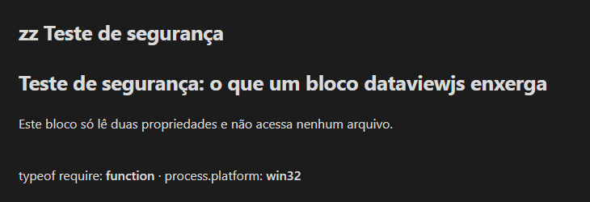
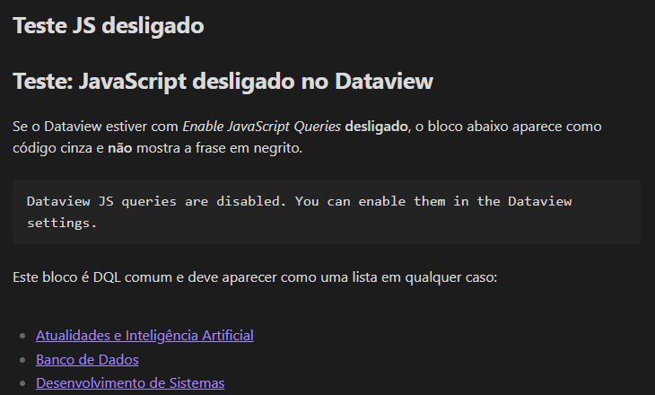

<!-- _paginate: false -->

# Agente de Estudos para Concursos
### Do edital em PDF ao plano de estudos no Obsidian, sem perder uma linha

Tendências em Ciência da Computação · Unidade IV, Agentes e Ética · UDF 2026/2

---

## O problema

- O edital define **tudo**: disciplinas, pesos, penalização, mínimos e a lista exata de tópicos
- Verticalizar à mão leva horas. **Um tópico pulado só aparece na prova**
- Pedir a um chatbot é rápido, mas listas longas viram "*… e demais tópicos*"
- Retificações mudam o edital no meio do estudo

**Objetivo:** um agente que organiza o edital com IA e **prova por código** que nada foi perdido ou inventado.

---

## Prompt direto × agente

| | Chat comum | Agente de Concursos |
|---|---|---|
| Conteúdo programático | pode ser resumido | **literal + cobertura 100%** |
| Origem dos dados | não informada | item e página do edital |
| Regras da banca | "memória" do modelo | só do edital ("NÃO CONSTA") |
| Retificação | refazer tudo | diff + confirmação |
| PDF malicioso | pode obedecer | detectado e tratado como dado |
| Progresso | fora da conversa | checklist no Obsidian, preservado |

---

## Arquitetura: 4 camadas

| Camada | Quem faz | O quê |
|---|---|---|
| **1. Perceptiva** | script | PDF → texto, OCR, cabeçalhos, **anti-injeção**, segmentação |
| **2. Cognitiva** | Claude + skill | estrutura, ficha com trechos literais, análise, anotações |
| **3. Decisória** | script | **cobertura**, **citações**, numeração, prioridade, proteção do progresso |
| **4. Executiva** | script + worker | grava no vault: Painel, Ficha, Verticalizado, Disciplinas |

**Princípio:** o modelo interpreta, o código confere.
Claude Console (Managed Agents) + worker no WSL + vault do Obsidian.

---

## Como a fidelidade é garantida

- **Cobertura:** compara o edital com o verticalizado **palavra por palavra, nos dois sentidos**
  - faltou → `FALTANDO` · inventou ou duplicou → `NÃO CONFERE` · só mudou de lugar → aviso
- **Citações:** cada campo da ficha precisa do item, do trecho literal e dos mesmos números
- **Retificação:** só aplica se o trecho casar exatamente 1 vez; `comparar` mostra o que mudou
- **Progresso:** nada é sobrescrito, a atualização vai para `_atualizacao-<data>/`

---

## Ética, privacidade e vieses

- **LGPD:** dados só do titular, no computador dele. Listas de candidatos (dados de terceiros) ficam **fora**
- **Segurança:** WSL sem acesso ao C: nem ao Windows. Chave de API fora do alcance do agente. Teto de gasto por sessão
- **Prompt injection:** PDF com "ignore as instruções…" ou pedindo código é sinalizado e **não obedecido**
- **Vieses:** regras da banca só do edital, estimativas marcadas, incidência neutra sem dado real, questões rotuladas como inéditas
- **Transparência:** item e página em cada dado, relatório de cobertura no vault

---

## Testes

| Cenário | Resultado |
|---|---|
| Edital numerado / sem numeração | ✓ cobertura 100% |
| IA omite, inventa, resume ou duplica | ✓ reprovado |
| Citação errada na ficha | ✓ reprovada |
| Retificação / reexecução | ✓ aplicada 1 vez, rastreável |
| Prompt injection no PDF | ✓ sinalizado, texto preservado |
| Progresso marcado + reexportação | ✓ nenhum `[x]` perdido |
| Padrões de editais reais (quadro de vagas, OCR, cabeçalhos) | ✓ 5 casos novos, um por defeito achado |
| Painel sem JavaScript | ✓ nenhum `dataviewjs`, auditoria limpa |

**39/39 casos passando**, sem conta nem internet · teste de mutação: **7/7 defeitos detectados**

---

## Validação em campo (23/11/2026)

| Sessão (Console + worker no WSL) | Resultado conferido | Custo |
|---|---|---|
| Edital fictício, 4 páginas | cobertura 100% · 27 citações · 1 min 42 s | US$&nbsp;0,27 |
| **Edital real DATAPREV 2026, 64 páginas** | cobertura 100% (20.430 palavras) · 68 citações · **11/11 regras e contas conferidas no PDF** · 8 min | **US$&nbsp;1,49** |
| Ataque controlado | 5/5 verificações | US$&nbsp;0,08 |

- **10 defeitos achados e corrigidos**, cada um virou teste. 5 vieram de editais reais: quadro de vagas numerado, assinatura descartada, falso alerta em "Powershell", cabeçalho com dois-pontos e ruído de OCR
- O resumo em texto do agente errou contagens (69 citações em vez de 68). **Nenhum dado conferido por código errou**

---

## Segurança do vault

**Risco confirmado no teste:** uma nota com `dataviewjs` roda no Windows, com acesso ao Node, fora do WSL. Um edital com injeção poderia usar o agente para plantar código.

| # | Mitigação | Efeito | Em campo |
|---|---|---|---|
| M1 | Regra no prompt + detecção | agente recusa | ✓ recusou até a pedido do usuário |
| M2 | `.obsidian` somente leitura, sem `sudo` | plugins bloqueados | ✓ |
| M3 | `auditar` ao fim da sessão | código detectado | ✓ acusou a nota de teste |
| M4 | Painel só DQL, JavaScript desligado | **código não roda** | ✓ Painel inteiro funcionando |

**Risco aceito:** a chave do ambiente é legível pelo agente. Vale só para este ambiente e será revogada após a apresentação.

---

## Conclusão

**Vantagens:** fidelidade comprovável · estudo num lugar só · custo medido de US$ 1,49 num edital real de 64 páginas
**Limitações:** Managed Agents em beta · um edital real de ponta a ponta · tabelas e OCR exigem conferência · heurísticas · quem religar o JavaScript do Dataview volta a depender de M1–M3

**Próximos passos:** incidência real por tópico · avaliação automática da ficha (*evals*) · checagem semanal de retificações

> IA confiável não é a que acerta sempre: é a que **prova** quando acertou.
