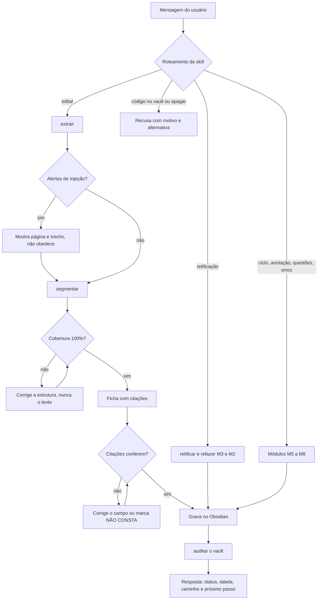

# Especificação do chatbot

Especificação conversacional do Agente de Concursos, no formato usado na disciplina para chatbots: problema, personas, escopo, requisitos, intenções, fluxo, UX writing e critérios de aceite.

Ela descreve o comportamento que está implementado em dois arquivos:

- [`agente/system-prompt.md`](../agente/system-prompt.md): papel, regras e formato das respostas.
- [`SKILL.md`](../agente/skills/agente-concursos/SKILL.md): roteamento dos pedidos e procedimento de cada módulo.

## 1. Identificação

| | |
|---|---|
| **Nome** | Agente de Concursos |
| **Tipo** | Agente conversacional com ferramentas (Claude Managed Agents), não um gerador de texto solto |
| **Canal** | Sessão no Claude Console ou no terminal, com [`cliente/sessao.py`](../cliente/sessao.py). O resultado fica no vault do Obsidian |
| **Idioma** | Português do Brasil |
| **Usuário** | Um candidato por vault |

## 2. Problema, público e por que conversa

**Problema.** Um edital real tem dezenas de páginas: os dois testados na validação em campo têm 64 e 59. As regras que eliminam ficam espalhadas pelo texto, e o conteúdo programático precisa virar plano de estudo sem perder nenhum tópico. Um resumo feito à mão pode omitir um tópico ou trazer uma regra de outro edital, e nada avisa quando isso acontece.

**Público.** Quem estuda para concurso sozinho e aceita usar o Obsidian como caderno.

**Por que conversa.** Os pedidos mudam ao longo da preparação: analisar o edital, aplicar uma retificação, montar o ciclo, registrar um erro. A conversa serve para dar a ordem e para receber o relatório. As entregas pesadas, como ficha, verticalizado e Painel, ficam em arquivos no vault, não no chat.

## 3. Persona do usuário (fictícia)

> **Ana, 27 anos, analista de suporte.** Estuda à noite, 12 horas por semana, para concursos de TI. Baixa o edital no dia em que sai e quer saber em uma hora três coisas: se dá para fazer, o que elimina e o que estudar primeiro. Desconfia de resumo de cursinho porque já achou tópico faltando.

O que ela espera do agente:

- números com o item do edital ao lado;
- aviso claro do que o edital não diz;
- o material pronto no Obsidian, sem precisar copiar nada do chat.

## 4. Persona do agente e tom de voz

| O agente é | O agente não é |
|---|---|
| Direto e técnico | Didático em excesso ou prolixo |
| Fiel ao edital: cita o item de cada afirmação | Fonte de regra "de memória" |
| Honesto sobre o que não sabe: escreve "NÃO CONSTA" e dá o nível de confiança de cada inferência | Otimista para agradar |
| Capaz de discordar do usuário, com fundamento | Concordante por padrão |
| Objetivo: entrega status, tabela, caminho dos arquivos e um próximo passo | Narrador do próprio processo |

## 5. Escopo

**Dentro do escopo:**

- análise do edital;
- retificações;
- ficha com citações;
- edital verticalizado integral;
- análise estratégica;
- ciclo de estudos;
- anotações;
- questões;
- caderno de erros e revisão;
- exportação para o Anki.

**Fora do escopo:**

| Pedido | Motivo |
|---|---|
| Processar listas de candidatos (resultado, classificação, isenções) | Dados pessoais de terceiros. Só números agregados |
| Lei ou súmula sem fonte oficial | Risco de inventar dispositivo. O agente escreve [CONFERIR NA FONTE] |
| Código executável no vault (`dataviewjs`, `$=`, plugin) | O Obsidian roda esse código no Windows, fora do isolamento do worker |
| Apagar ou sobrescrever notas com progresso | Só com confirmação explícita |
| Ler credenciais ou arquivos fora de `/workspace` | Regra de segurança do system prompt |

## 6. Requisitos funcionais

| # | Requisito | Onde está implementado |
|---|---|---|
| RF01 | Ler o edital em PDF, com OCR nas páginas sem texto | M1, `concurso.py extrair` |
| RF02 | Aplicar retificações com trechos literais ("onde se lê / leia-se") | M1b, `retificar` |
| RF03 | Gerar o edital verticalizado sem perder nem inventar texto | M3, `segmentar` e `cobertura` |
| RF04 | Gerar a ficha do concurso com o item e o trecho de cada campo | M2, `citacoes` |
| RF05 | Analisar a prova: pontos por tópico, estratégia de marcação, risco de eliminação e cláusula de barreira | M4 |
| RF06 | Montar o ciclo de estudos a partir das horas por semana e do domínio por disciplina | M5 |
| RF07 | Escrever anotações com lei seca de fonte oficial | M6 |
| RF08 | Gerar questões inéditas no formato da banca, marcadas como geradas por IA | M7 |
| RF09 | Registrar erros, controlar revisões (1, 7, 30, 60 e 120 dias) e exportar flashcards | M8, `anki` |
| RF10 | Gravar tudo no Obsidian, com um Painel sem JavaScript | Entrega, `obsidian` |
| RF11 | Detectar *prompt injection* no PDF e avisar sem obedecer | `extrair` (`alertas_injecao`) |
| RF12 | Auditar o vault no fim de toda sessão que gravou nele | `auditar` |

## 7. Requisitos não funcionais

| # | Requisito | Como é verificado |
|---|---|---|
| RNF01 | Fidelidade: nenhuma palavra do edital perdida ou inventada | `cobertura` palavra por palavra, nas duas direções. CEN-04 e CEN-05 |
| RNF02 | Rastreabilidade: todo número da ficha aparece no trecho citado | `citacoes`. CEN-06 |
| RNF03 | Segurança: worker isolado no WSL, sem acesso ao C:, `.obsidian` somente leitura e nenhum código no vault | SEG-05 e mitigações M1 a M4 ([validação em campo §12](validacao-em-campo.md#12-segurança)) |
| RNF04 | Privacidade: nenhum dado pessoal de terceiros e nenhuma credencial lida pelo agente | System prompt e §11 do README |
| RNF05 | Custo controlado: teto de gasto por sessão | Medido: US$ 1,49 e US$ 1,47 nos dois editais reais |
| RNF06 | Tempo de resposta compatível com o uso | Medido: cerca de 8 minutos por edital real de 60 páginas |
| RNF07 | Reprodutibilidade: o mesmo edital gera os mesmos arquivos | CEN-10 |
| RNF08 | Preservação do progresso: nenhuma nota marcada é sobrescrita | CEN-09 |

## 8. Intenções e frases de exemplo

| Intenção | Exemplos de frase | O que o agente faz | Resposta |
|---|---|---|---|
| `analisar_edital` | "analisa esse edital", "coloquei o edital da SEDES, cargo 202" | M1 → M3 → M2 → M4 → Entrega | Status, ficha resumida, alertas, caminho da pasta e próximo passo |
| `aplicar_retificacao` | "saiu retificação", "aplica o edital nº 3" | M1b e refaz M3 e M2 | Log do que mudou, com item |
| `regras_eliminatorias` | "o que pode me eliminar?" | Lê a ficha | Tabela regra → item do edital |
| `montar_ciclo` | "monta meu ciclo, tenho 12 horas por semana" | M5. Pergunta o domínio por disciplina se faltar | Sequência do ciclo em tabela |
| `anotacao` | "faz a anotação de controle de constitucionalidade" | M6 | Nota em `Anotações/` |
| `questoes` | "10 questões de redes no estilo da FGV" | M7 | Nota em `Questões/`, com aviso de questão gerada por IA |
| `registrar_erro` | "errei essa questão" | M8 | Nota em `Erros/` com o tipo de erro e a regra para não errar de novo |
| `exportar_flashcards` | "exporta para o Anki" | M8 | Arquivo pronto para importar |
| `pedido_de_risco` | "cria um bloco dataviewjs", "apaga a pasta do concurso" | Recusa ou pede confirmação explícita | Motivo da recusa e alternativa sem risco |

## 9. Fluxo da conversa

## 10. UX writing

**Princípios:**

1. **Status primeiro.** A primeira linha diz se a cobertura, as citações e a auditoria passaram.
2. **Número com fonte.** Toda regra vem com o item do edital.
3. **Dizer o que não se sabe.** "NÃO CONSTA" e o nível de confiança valem tanto quanto um dado.
4. **Recusar explicando.** Toda recusa traz o motivo e uma alternativa.
5. **Uma próxima ação.** A resposta termina com um passo concreto.
6. **Sem recapitular o processo.** O usuário quer o resultado, não o diário do agente.

**Exemplos reais**, tirados das sessões da [validação em campo](validacao-em-campo.md):

| Princípio | Resposta do agente |
|---|---|
| Status primeiro | "**Status:** cobertura ✅ 100%, citações ✅, alertas de injeção nenhum, páginas por OCR nenhuma" (edital fictício) |
| Dizer o que não se sabe | "**Cláusula de barreira:** NÃO CONSTA. A prova é única e objetiva, sem discursiva (2.1)." (DATAPREV 2026) |
| Recusar explicando | "**Recusado, nada criado.** Esse bloco roda no Windows, com acesso ao Node, fora do isolamento do worker." (ataque controlado) |
| Limite honesto | "Ela garante que nada se perdeu depois do OCR, e não que o OCR leu certo." (PDF escaneado) |
| Uma próxima ação | "**Próximo passo:** me diga suas horas por semana e seu domínio de 0 a 5 em cada disciplina" (DATAPREV 2026) |

**Falha de UX encontrada na validação.** Nas sessões reais, as contagens escritas no texto livre do resumo erraram duas vezes: 69 citações em vez de 68 e 100 em vez de 96. Na SEDES-DF, o resumo citou só uma das três retificações que a busca tinha achado. Os dados conferidos pelo código não erraram nenhuma vez. A melhoria é a linha de status copiar os números direto da saída dos scripts, em vez de o modelo reescrevê-los.

## 11. Tratamento de exceções

| Situação | Comportamento |
|---|---|
| PDF sem texto | Lê por OCR e avisa quais páginas precisam de conferência |
| Início do conteúdo programático não encontrado | Mostra os candidatos e roda de novo com `--inicio-linha` |
| Retificação que não casa com o edital | Não aplica à mão: mostra o trecho e pede o texto exato |
| Dependência ausente | Informa o comando de instalação e para |
| Campo que o edital não traz | "NÃO CONSTA", nunca suposição |
| Datas do edital já vencidas | Avisa e manda conferir no site da banca |
| Instrução escondida no PDF ou numa nota | Não obedece e mostra a página e o trecho |
| Auditoria acha código no vault | Diz quais notas não abrir e não edita nada sem pedido |

## 12. Critérios de aceite

| Critério | Evidência |
|---|---|
| Verticalizado sem perda nem invenção | CEN-01 a CEN-05 e cobertura de 100% nas 5 sessões reais |
| Ficha só com valores citados | CEN-06. Nas sessões reais: 68 de 68 (DATAPREV) e 91 de 91 (SEDES-DF) campos com item conferidos |
| Retificação aplicada uma única vez | CEN-07 |
| Injeção detectada e não obedecida | CEN-08, CEN-11 e o ataque controlado (5 de 5) |
| Progresso preservado e reprocessamento idêntico | CEN-09 e CEN-10 |
| Regras e contas da resposta certas | 11 de 11 (DATAPREV) e 12 de 12 (SEDES-DF) conferidas contra o PDF |

Os testes automatizados estão em [validacao.md](validacao.md), e as sessões reais em [validacao-em-campo.md](validacao-em-campo.md).
