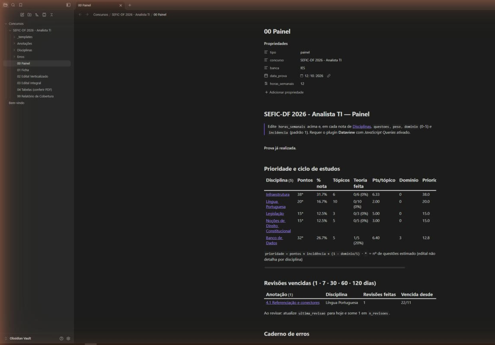
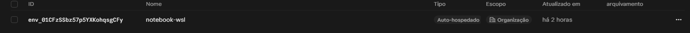
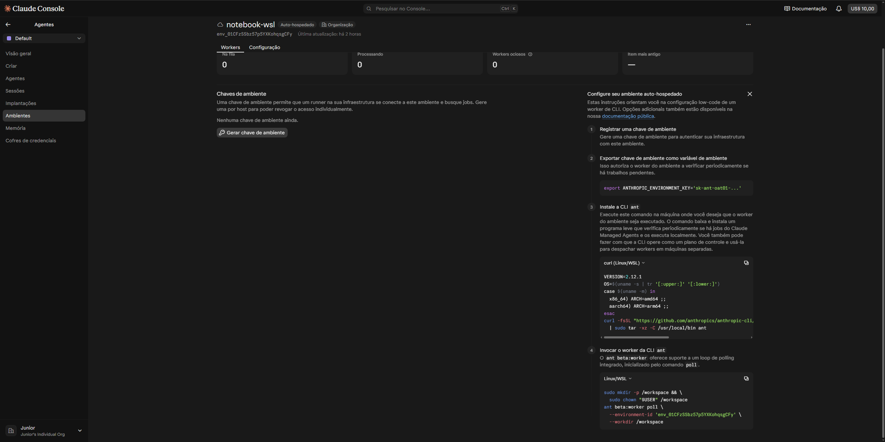
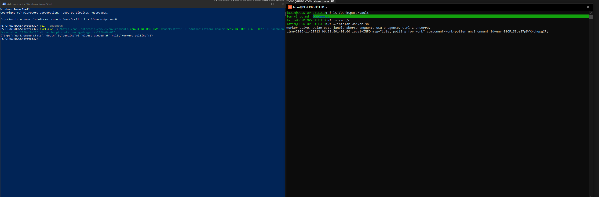

# Validação em campo

Registro completo da validação do Agente de Estudos para Concursos numa máquina real, em **23/11/2026**: o que foi testado, como, com quais comandos, o que saiu, o que deu errado, como foi corrigido e quanto custou.

Todos os horários estão no fuso de Brasília (UTC−3). Os IDs de recursos aparecem por inteiro porque não são credenciais: sem a chave de API, ninguém consegue usá-los. Nenhuma chave aparece neste documento nem nas evidências.

## Sumário

1. [Resumo](#1-resumo)
2. [Objetivo e escopo](#2-objetivo-e-escopo)
3. [Ambiente](#3-ambiente)
4. [Recursos criados](#4-recursos-criados)
5. [Linha do tempo](#5-linha-do-tempo)
6. [Etapa A: Painel do Obsidian](#6-etapa-a-painel-do-obsidian)
7. [Etapa B: chave de API, skill, ambiente e agente](#7-etapa-b-chave-de-api-skill-ambiente-e-agente)
8. [Etapa C: worker no WSL](#8-etapa-c-worker-no-wsl)
9. [Etapa D: sessão real do agente](#9-etapa-d-sessão-real-do-agente)
10. [Conferência independente do resultado](#10-conferência-independente-do-resultado)
11. [Problemas encontrados e correções](#11-problemas-encontrados-e-correções)
12. [Segurança](#12-segurança)
13. [Custo](#13-custo)
14. [O que não foi validado](#14-o-que-não-foi-validado)
15. [Como reproduzir](#15-como-reproduzir)
16. [Arquivos de evidência](#16-arquivos-de-evidência)

---

## 1. Resumo

| Item | Antes | Depois de 23/11 | Evidência |
|---|---|---|---|
| Painel do Obsidian (Dataview) | JavaScript só compilado com Node | ✅ Renderiza no app, e marcar um tópico atualiza o Painel | [§6](#6-etapa-a-painel-do-obsidian) |
| Agente no Console | Sem sessão real | ✅ Sessão real processou o edital fictício de ponta a ponta | [§9](#9-etapa-d-sessão-real-do-agente) |
| Worker self-hosted no WSL | Não executado | ✅ Vault montado, C: fora do alcance do agente, worker conectado | [§8](#8-etapa-c-worker-no-wsl) |

| Número | Valor |
|---|---|
| Cobertura do conteúdo programático | 291 de 291 palavras (100%) |
| Cobertura do corpo do edital | 391 de 391 palavras (100%) |
| Citações da ficha | 27 conferidas pelo script, 15 campos marcados NÃO CONSTA |
| Chamadas de ferramenta do agente | 18 (12 `bash`, 5 `write`, 1 `read`) |
| Chamadas ao modelo | 13 |
| Tempo do pedido à resposta final | 1 min 42 s (execução ativa cobrada: 90 s) |
| Custo da sessão | **US$ 0,27**, com teto de US$ 3,00 |
| Acessos do agente fora de `/workspace` | 0 |
| Defeitos do projeto encontrados | 3, todos corrigidos e cobertos por teste (REG-14, SEG-07, SEG-04 ampliado) |
| Problemas de procedimento encontrados | 4, todos com o guia de instalação corrigido |

## 2. Objetivo e escopo

Até esta data, o projeto tinha 29 testes automatizados que rodam sem conta e sem internet. Faltava provar três coisas que só uma máquina real prova:

1. O Painel do Obsidian renderiza de verdade no app, e não só compila.
2. O worker self-hosted roda no WSL com o isolamento planejado.
3. O agente, configurado no Console, executa o fluxo inteiro sozinho e grava um resultado correto no vault.

**Dentro do escopo:** um edital fictício de 4 páginas (`edital-sefic-2026.pdf`, gerado por `demo/editais_ficticios.py`), o vault Obsidian do autor e uma única sessão do agente.
**Fora do escopo:** editais reais, PDFs escaneados (OCR) e os testes de integração I2 a I8 de [instalacao.md](instalacao.md).

## 3. Ambiente

| Camada | Componente | Versão |
|---|---|---|
| Máquina | Notebook pessoal do autor | Windows 10 (pelo visual da barra de tarefas; build não registrada) |
| Base de estudo | Obsidian | 1.15.1 |
| | Dataview | 0.5.68, com *Enable JavaScript Queries* ligado |
| Worker | WSL 2 + Ubuntu | 26.04 ("resolute"), instalado por `wsl --install -d Ubuntu` |
| | Python | 3.14.3 |
| | PyMuPDF / pdfplumber / openpyxl / pytesseract | 2.1 / 0.11.11 / 3.1.5 / 0.3.13 |
| | Tesseract OCR + idioma `por` | 5.5.0 |
| | `ant` CLI (worker) | 2.12.1 |
| API | Versão | `anthropic-version: 2026-10-21` |
| | Betas | `managed-agents-2026-04-01`, `skills-2025-10-02` |
| Agente | Modelo | `claude-sonnet-5-5`, esforço `high` (padrão) |
| | Ferramentas | `agent_toolset_20260401`, política `always_allow` (padrão) |
| Cliente | Windows PowerShell 5.1 + `curl.exe` | Sem Python no Windows |
| Testes automatizados | Python + PyMuPDF (máquina de desenvolvimento) | 3.13.18 + 2.1, a mesma versão do PyMuPDF do worker |

## 4. Recursos criados

| Recurso | ID | Observação |
|---|---|---|
| Skill | `skill_01BC1APou3piHmwBALWcYtkA` | Nome `agente-concursos` |
| Versão 1 da skill | `1795444039522038` | Usada na sessão de validação |
| Versão 2 da skill | `1795450861965344` | Corrige a Ficha (defeito D1, [§11](#11-problemas-encontrados-e-correções)) |
| Ambiente | `env_01CFzSSbz57p5YXKohqsgCFy` | `notebook-wsl`, tipo `self_hosted`, escopo Organização |
| Chave do ambiente | — | 108 caracteres, prefixo `sk-ant-oat01`. Fica só em `~/.concurso-worker.env` no Ubuntu |
| Agente | `agent_011fo9cfGSnpr8aAGGQouAEN` | Versão 1 |
| Sessão | `sesn_01NjucVhopBAyHbvnmw1FWfK` | "Validação A1 - edital SEFIC-DF", teto de US$ 3,00 |

## 5. Linha do tempo

| Hora | O que aconteceu |
|---|---|
| 11:04 | Dataview 0.5.68 instalado e ativado. *Enable JavaScript Queries* ligado |
| 11:05 | Painel, Verticalizado, Ficha e Edital Integral abertos e capturados |
| 11:06 | Um tópico marcado no Verticalizado aparece no Painel. Marcação desfeita |
| 11:20 | Escolhido o tipo de credencial: chave de API ("Em outro lugar") |
| 11:23 | Chave gravada no Windows com `setx` e conferida pelo prefixo |
| 11:27 | Chave testada (HTTP 200) e skill enviada (versão 1) |
| 11:29 | Ambiente e agente criados pela API |
| 11:30 | `wsl --install -d Ubuntu-24.04` falha: nome de distribuição inválido (P1) |
| até 12:55 | Ubuntu 26.04 instalado e `setup-wsl.sh` executado sem erro |
| 12:57 | Conferência mostra que a chave gravada é texto de comando (P2) |
| 13:04 | Chave do ambiente gravada corretamente (108 caracteres) |
| 13:06:28 | Worker ativo. A API mostra `workers_polling: 1` |
| 13:09:33 | Sessão criada |
| 13:09:35 | Pedido enviado ao agente |
| 13:11:00 | Agente grava o material no vault |
| 13:11:17 | Resposta final do agente. Sessão fica ociosa |
| 13:12–13:20 | Conferência independente. Defeito D1 encontrado, corrigido e coberto pelo REG-14 |
| 13:21 | Versão 2 da skill enviada |
| 13:25 | Eventos da sessão exportados pela API para este relatório |

## 6. Etapa A: Painel do Obsidian

**Como:** o vault de demonstração (`Concursos/SEFIC-DF 2026 - Analista TI`, gerado por `demo/demo.py`) foi aberto no Obsidian. O Dataview foi instalado pelo navegador de plugins da comunidade, ativado, e a opção *Enable JavaScript Queries* foi ligada. Cada nota foi aberta e capturada.

| # | Verificação | Resultado | Captura |
|---|---|---|---|
| OB-01 | Tabela de prioridade com 5 disciplinas | ✅ Banco de Dados, com domínio 3, cai para prioridade 12,8. As demais seguem `pontos × incidência` | [01](resultados/obsidian/01-painel-prioridade.jpg) |
| OB-02 | Revisões vencidas (1·7·30·60·120 dias) | ✅ Anotação 4.1 vencida desde 22/11 (última revisão 15/11 + 7 dias) | [02](resultados/obsidian/02-painel-revisoes-erros.jpg) |
| OB-03 | Caderno de erros por tipo | ✅ Infraestrutura com 1 erro de pegadinha | [02](resultados/obsidian/02-painel-revisoes-erros.jpg) |
| OB-04 | Contagem regressiva | ✅ "Prova já realizada", correto para 12/10/2026. O ramo com dias restantes não apareceu | [01](resultados/obsidian/01-painel-prioridade.jpg) |
| OB-05 | Verticalizado com as notas de disciplina embutidas e o quadro de observações | ✅ | [03](resultados/obsidian/03-verticalizado-embeds.jpg) |
| OB-06 | Marcar um tópico no Verticalizado grava na nota da disciplina e atualiza o Painel | ✅ Língua Portuguesa foi de 0/10 para 1/10. Marcação desfeita depois | [04](resultados/obsidian/04-painel-apos-marcar-topico.jpg) |
| OB-07 | Ficha com link para o item do edital em cada campo | ✅ | [05](resultados/obsidian/05-ficha-fontes.jpg) |
| OB-08 | O link da Ficha abre o Edital Integral no item certo | ✅ O item 5.2 abre destacado | [06](resultados/obsidian/06-link-ficha-para-integral.jpg) |



## 7. Etapa B: chave de API, skill, ambiente e agente

Todos os comandos desta etapa rodaram no **PowerShell do Windows**. A chave de API não foi para o Ubuntu, como a documentação recomenda: tudo que está no host do worker pode ser lido pelas ferramentas do agente.

### 7.1 Tipo de credencial

O Console oferece quatro formas de conexão. A escolha considerou o que o projeto já usava.


| Opção | Funciona com o projeto como está? | Segredo guardado na máquina | Decisão |
|---|---|---|---|
| Em outro lugar (chave de API) | Sim: `cliente/sessao.py` e os comandos `curl.exe` | Sim, a chave | **Escolhida**: menor risco a 3 dias da entrega |
| Seu próprio computador (login pela CLI `ant`) | Provavelmente. O SDK lê o perfil ativo do login, mas o envio da skill teria de mudar e isso não estava testado | Não | Fica como melhoria |
| Nuvem/Kubernetes e Pipeline de CI | Não se aplicam a um notebook | — | Descartadas |

A chave gerada tem o prefixo `sk-ant-usr`, diferente do `sk-ant-api03` dos exemplos da documentação. Ela funcionou com o cabeçalho `Authorization: Bearer`, e por isso todos os comandos do projeto passaram a usar esse cabeçalho.

### 7.2 Teste da chave e envio da skill

```powershell
curl.exe -s -o NUL -w "teste da chave: %{http_code}`n" https://api.anthropic.com/v1/models -H "Authorization: Bearer $env:ANTHROPIC_API_KEY" -H "anthropic-version: 2026-10-21"
curl.exe -s https://api.anthropic.com/v1/skills -H "Authorization: Bearer $env:ANTHROPIC_API_KEY" -H "anthropic-version: 2026-10-21" -H "anthropic-beta: skills-2025-10-02" -F "files[]=@agente-concursos/SKILL.md;filename=agente-concursos/SKILL.md" -F "files[]=@agente-concursos/scripts/concurso.py;filename=agente-concursos/scripts/concurso.py"
```

Saída:

```text
teste da chave: 200
{"type":"skill","id":"skill_01BC1APou3piHmwBALWcYtkA","created_at":"2026-11-23T14:27:20.123577Z","updated_at":"2026-11-23T14:27:20.123577Z","display_title":"agente-concursos","source":"custom","latest_version":"1795444039522038"}
```

A skill foi enviada arquivo por arquivo, dentro da pasta `agente-concursos/`, e não como zip. É o formato da referência atual da API: todos os arquivos numa única pasta de topo, com o `SKILL.md` nela.

### 7.3 Ambiente e agente

As requisições usaram os arquivos de [resultados/campo/payloads/](resultados/campo/payloads/). Os modelos reutilizáveis ficam em `agente/api/`.

| Arquivo | Conteúdo |
|---|---|
| `ambiente.json` | `{"name": "notebook-wsl", "config": {"type": "self_hosted"}}` e uma descrição |
| `agente.json` | Nome, descrição, `claude-sonnet-5-5`, o system prompt inteiro de `agente/system-prompt.md`, `agent_toolset_20260401` e a skill sem versão fixa (usa a mais recente) |

O bloco de comandos (está em [instalacao.md](instalacao.md), Etapa 2) criou os dois recursos e gravou os IDs nas variáveis do Windows:

```text
ambiente: env_01CFzSSbz57p5YXKohqsgCFy
ÊXITO: o valor especificado foi salvo.
agente: agent_011fo9cfGSnpr8aAGGQouAEN
ÊXITO: o valor especificado foi salvo.
```



## 8. Etapa C: worker no WSL

### 8.1 Instalação

`wsl --install -d Ubuntu-24.04` falhou com "Nome de distribuição inválido" (problema P1). Com `wsl --install -d Ubuntu`, o WSL instalou o Ubuntu 26.04 e abriu direto, sem precisar reiniciar.

O `setup-wsl.sh` rodou sem erro. O [log completo](resultados/campo/setup-wsl.log) mostra:

| Passo do setup | Resultado |
|---|---|
| Pacotes do sistema (Python, pip, Tesseract + `por`, curl, unzip) | 22 instalados, 4 atualizados |
| Bibliotecas Python | PyMuPDF 2.1, pdfplumber 0.11.11, openpyxl 3.1.5, pytesseract 0.3.13 (instalação no usuário, avisos de PATH sem efeito) |
| `ant` CLI | `ant version 2.12.1` |
| `/workspace/vault` e `/etc/fstab` | Montagem só da pasta do vault, com o espaço do caminho escapado como `\040` |
| `/etc/wsl.conf` | Automount do C: desligado, interop desligado, Windows fora do PATH |

### 8.2 Chave do ambiente

A chave do ambiente só pode ser gerada no Console, mesmo para um ambiente criado pela API. A tela do ambiente mostrou "Nenhuma chave de ambiente ainda" e o botão **Gerar chave de ambiente**.



A primeira tentativa de gravar a chave falhou sem dar erro (problema P2). A conferência mostrou que o arquivo tinha 183 caracteres começando com `cat > ~/.con`, ou seja, o texto do próprio comando.


A segunda tentativa usou um comando de uma linha que só grava se o texto começar com `sk-ant-`:

```text
ok: sk-ant-oat01... (108 caracteres)
```

Esse comando virou o script `~/gravar-chave.sh`, que o `setup-wsl.sh` agora cria, e ganhou o teste SEG-07.

### 8.3 Isolamento e conexão

Depois de `wsl --shutdown` e de reabrir o Ubuntu:

| # | Verificação | Comando | Resultado |
|---|---|---|---|
| WS-01 | Vault montado | `ls /workspace/vault` | ✅ `Bem-vindo.md` e `Concursos` |
| WS-02 | C: fora do alcance | `ls /mnt/c` | ✅ Pasta vazia: o C: não está montado. O guia dizia que daria erro; vazio também é o resultado certo (problema P3) |
| WS-03 | Aviso de isolamento | `~/iniciar-worker.sh` | ✅ Não apareceu o aviso de que `/mnt/c/Windows` existe |
| WS-04 | Worker ativo | `~/iniciar-worker.sh` | ✅ `level=INFO msg="idle; polling for work" environment_id=env_01CFzSSbz57p5YXKohqsgCFy` |
| WS-05 | Worker conectado | `GET /v1/environments/{id}/work/stats` | ✅ `{"type":"work_queue_stats","depth":0,"pending":0,"oldest_queued_at":null,"workers_polling":1}` |



## 9. Etapa D: sessão real do agente

### 9.1 Preparação

O PDF do edital fictício foi colocado em `_editais/edital-sefic-2026.pdf` no vault. A sessão foi criada com teto de US$ 3,00 (`"amount": "300"`, em centavos), e o pedido foi enviado logo em seguida.

**Pedido enviado** ([mensagem.json](resultados/campo/payloads/mensagem.json)):

> Teste de validação do agente.
> 1) Confirme o ambiente: liste /workspace, /workspace/skills e /workspace/vault.
> 2) Processe o edital /workspace/vault/_editais/edital-sefic-2026.pdf seguindo a skill agente-concursos do início ao fim: extrair, segmentar, ficha com citações validada, cobertura e gravação no Obsidian. Use o nome de concurso 'SEFIC-DF 2026 - Teste Agente'. Não altere a pasta 'Concursos/SEFIC-DF 2026 - Analista TI'. Se faltar um dado do perfil, siga com o padrão e registre a suposição.
> 3) No fim, responda com: resultado da cobertura, resultado das citações, alertas de injeção (se houver), custo aproximado em chamadas de ferramenta e a lista de arquivos criados no vault.

### 9.2 O que o agente fez

A sequência completa, com horário, comando, saída e interpretação de cada passo, está em [sessao-linha-do-tempo.md](resultados/campo/sessao-linha-do-tempo.md). Em resumo:

| Fase | Chamadas | O que aconteceu |
|---|---|---|
| Reconhecimento | 1–3 | Listou `/workspace`, leu o `SKILL.md`, conferiu as bibliotecas. Procurou o perfil do candidato, que não existe |
| Camadas 1 a 3 | 4–7 | Extraiu o PDF, segmentou corpo e conteúdo programático, rodou a cobertura (100%) e inspecionou observações e assinatura |
| Ficha | 8–12 | Escreveu a ficha. O script de citações reprovou 6 campos. O agente releu, corrigiu e revalidou: todas conferem |
| Análise | 13–17 | Leu o script para entender horas e pesos, escreveu `pesos.json` e a análise estratégica, e ajustou a análise |
| Camada 4 | 18 | Rodou cobertura e citações de novo e gravou o material no vault |

**A primeira rodada de citações reprovou 6 campos, e isso é o comportamento planejado.** O script existe para pegar exatamente isso. As correções do agente foram:

| Campo reprovado | Motivo | Correção do agente |
|---|---|---|
| Órgão | Não existe item numerado com o órgão | Marcado NÃO CONSTA, com a explicação de que só aparece no cabeçalho do PDF |
| Mínimo P1, P2 e conjunto (3 campos) | O valor tinha percentuais calculados, que não estão no trecho | Marcados como derivados |
| Data de corte da legislação | O item 6.1 não está em `itens.json`, porque fica no conteúdo programático | Citado como `programatico` |
| Legislação cobrada | Várias leis num campo só | Separadas, uma por campo, cada uma com o seu trecho |

### 9.3 Resultado gravado no vault

Em `Concursos/SEFIC-DF 2026 - Teste Agente/`: 14 notas (Painel, Ficha, Verticalizado, Integral, Tabelas, Análise Estratégica, Relatório de Cobertura, 5 disciplinas e 2 modelos) e 3 pastas vazias (Anotações, Questões, Erros). Em `.concursos-work/sefic-df-2026-teste-agente/`: 13 arquivos de trabalho.

| # | Verificação | Resultado |
|---|---|---|
| AG-01 | O agente encontra a skill em `/workspace/skills/agente-concursos` | ✅ |
| AG-02 | Cobertura | ✅ 291/291 e 391/391, nada faltando, nada alterado |
| AG-03 | Citações | ✅ 27 com citação e 15 NÃO CONSTA, depois da correção automática |
| AG-04 | Pasta da demonstração intacta | ✅ |
| AG-05 | Alerta de quadro ausente no item 4.1 | ✅ Alerta correto |
| AG-06 | Contas dos mínimos | ✅ |
| AG-07 | Nenhum acesso fora de `/workspace` | ✅ |

As mensagens do agente, sem edição, estão em [sessao-mensagens-do-agente.md](resultados/campo/sessao-mensagens-do-agente.md).

## 10. Conferência independente do resultado

O resumo do agente não foi aceito como prova. Cada afirmação foi conferida contra uma fonte independente: os arquivos do vault, o PDF, a API ou a conta feita à mão.

| Afirmação do agente | Como foi conferida | Resultado |
|---|---|---|
| Cobertura 100% (291/291 e 391/391) | `99 Relatório de Cobertura.md` lido direto do vault | ✅ |
| Todas as citações conferem | Chamada 18 da linha do tempo: o script de citações rodou de novo e devolveu "Todas as citações conferem" | ✅ |
| A pasta da demonstração ficou intacta | Datas de modificação: nenhum arquivo depois de 11:06:08. A sessão começou às 13:09:33 | ✅ |
| O item 4.1 cita um quadro que não veio na extração | PyMuPDF na página 2 do PDF: 0 tabelas. O texto diz "conforme o quadro a seguir" e não há quadro | ✅ Alerta correto: o PDF fictício não tem o quadro |
| Sem branco, os mínimos exigem 30, 46 e 78 acertos | `acertos = (itens + mínimo) / 2`: (50+10)/2 = 30; (70+21)/2 = 45,5 → 46; (120+36)/2 = 78 | ✅ |
| Com brancos, 25, 41 e 68 acertos | `acertos = (itens − brancos + mínimo) / 2` | ✅ |
| O corte do conjunto é o que mais pesa | 10 + 21 = 31 < 36 | ✅ |
| Itens estimados: 28/14/8 em P1 e 38/32 em P2 | Proporcional aos tópicos: 10/5/3 de 18 e 6/5 de 11 | ✅ |
| Horas por semana: 4,00 / 4,75 / 3,50 / 1,75 / 1,00 | `pontos / 120 × 15` | ✅ |
| Só marcar com mais de 50% de chance | Valor esperado de marcar = 2p − 1 | ✅ |
| "Cerca de 20 chamadas de ferramenta" | API: 18 chamadas | ⚠️ Aproximação aceitável |
| "Em 9 scripts repl" | Não corresponde a nada na API: as chamadas foram `bash`, `read` e `write` | ⚠️ Imprecisão do resumo |
| Lista de 10 arquivos de trabalho | O diretório tem 13: faltaram `citacoes.md`, `cobertura.md` e `corpo.txt` | ⚠️ Lista incompleta |
| Arquivos criados no vault | Listagem direta: as 14 notas e as 3 pastas existem | ✅ |

**Conclusão:** tudo que o script determinístico garante (cobertura, citações, gravação) bateu. As três imprecisões estão no texto livre do resumo do agente, nunca nos dados. Isso reforça a decisão de arquitetura: o modelo escreve, mas quem atesta é o código.

## 11. Problemas encontrados e correções

### 11.1 Defeitos do projeto

| # | Defeito | Causa | Correção | Teste |
|---|---|---|---|---|
| D1 | A Ficha saiu com a seção "Identificação" duas vezes | O `ficha.json` do agente repetiu a seção em dois pontos, e o `concurso.py` abria um bloco novo a cada troca de seção | O script agrupa os campos por seção, na ordem da primeira aparição. Skill republicada (versão 2) | REG-14: falha na versão antiga (`2 != 1`) e passa na nova |
| D2 | Colar a chave do ambiente no lugar errado gravava lixo sem avisar | O guia mandava editar o arquivo à mão ou usar um `read` sem conferência | `~/gravar-chave.sh`: recusa texto que não começa com `sk-ant-`, remove o `\r` do Windows, não mostra a chave e grava com permissão 600 | SEG-07 |
| D3 | O detector de credenciais do repositório não reconhecia o formato `sk-ant-usr-` | O padrão cobria só `api` e `oat` seguidos de dois dígitos | Padrão ampliado para qualquer prefixo de 3 letras | SEG-04 |

### 11.2 Problemas de procedimento

| # | Problema | Correção no guia |
|---|---|---|
| P1 | `wsl --install -d Ubuntu-24.04` deu "Nome de distribuição inválido" | Usar `wsl --install -d Ubuntu`. Linha nova em "Solução de problemas" |
| P2 | O prompt oculto do `read` recebeu o bloco de comandos colado inteiro em vez da chave. No terminal do Ubuntu, Ctrl+V não cola: é preciso usar o clique direito | Passo único com `~/gravar-chave.sh` e instrução de colar com o clique direito |
| P3 | O guia dizia que `ls /mnt/c` daria erro; ele vem vazio | Guia e `setup-wsl.sh` dizem "vazio (ou erro)" |
| P4 | O guia mandava enviar a skill como zip, formato que não foi testado | O guia usa o envio arquivo por arquivo, que foi o validado |

Além disso, os comandos do guia passaram a usar `Authorization: Bearer` (o formato validado), e o envio de JSON pela API ganhou modelos prontos em `agente/api/`.

### 11.3 Situações do edital fictício (não são defeitos)

| Situação | Efeito | Tratamento |
|---|---|---|
| A prova é em 12/10/2026, antes da data da validação | O Painel mostra "Prova já realizada" | Para a apresentação, trocar `data_prova` no topo do Painel por uma data futura |
| O item 4.1 cita um quadro que não existe | Itens por disciplina tiveram de ser estimados | O agente avisou e marcou a confiança como baixa |
| O perfil do candidato não existe no vault | O agente usou os padrões: 15 h por semana, domínio 0 e incidência 1 | Registrado como suposição na análise |

## 12. Segurança

### 12.1 O que foi verificado

| Controle | Como foi verificado | Resultado |
|---|---|---|
| Chave de API fora do host do worker | Ela só existe nas variáveis do Windows e nunca foi copiada para o Ubuntu | ✅ |
| Chave do ambiente protegida | `~/.concurso-worker.env` com permissão 600 (SEG-07) | ✅ |
| C: inteiro fora do alcance do agente | `ls /mnt/c` vazio e sem aviso no `iniciar-worker.sh` | ✅ |
| Agente restrito a `/workspace` | Busca em todos os 18 comandos da sessão por `/home`, `~/`, `env`, `printenv`, `ANTHROPIC`, `.concurso-worker`, `/mnt/`, `/etc/`, `curl`, `wget`: 0 ocorrências. Busca por `ANTHROPIC_` e `sk-ant` nas saídas: 0 | ✅ |
| Nenhuma chave nos arquivos exportados da sessão | Busca pelo padrão de chave nos 4 JSON exportados: 0 | ✅ |
| Nenhuma chave no repositório | SEG-04, agora cobrindo `sk-ant-usr-` | ✅ |
| Teto de gasto | `budget` na criação da sessão: US$ 3,00. Gasto real: US$ 0,27 | ✅ |
| Alerta de prompt injection | O edital fictício não tinha injeção, e o agente relatou "nenhum" | ✅ Coerente. O caso com injeção está coberto pelo CEN-08, que roda sem a API |

### 12.2 Riscos que continuam

| # | Risco | Confiança | Mitigação proposta |
|---|---|---|---|
| R1 | **A chave do ambiente pode ser lida pelo próprio agente.** O worker e as ferramentas do agente rodam com o mesmo usuário Linux, e a documentação avisa que as chamadas de ferramenta conseguem ler o que está no host do worker | Média. Não foi testado se o `ant` esconde o arquivo ou as variáveis dos processos do agente | A chave do ambiente só dá acesso à fila deste ambiente, não à conta. Gerar uma chave por host, como o Console recomenda, e revogar ao fim do uso. Rodar o worker com um usuário Linux dedicado reduziria o risco |
| R2 | **O vault é uma ponte para o Windows.** O agente pode escrever em `.obsidian/` (plugins) e em blocos `dataviewjs` de qualquer nota, e o Obsidian executa esse código no Windows quando a nota é aberta, fora do isolamento do WSL | A confirmar com o teste da nota `zz Teste de segurança` (§12.3) | Regra no system prompt proibindo escrever em `.obsidian/` e escrever `dataviewjs` fora dos modelos do script. Montar `.obsidian` como somente leitura no `fstab` do worker. Conferir os blocos `dataviewjs` antes de abrir notas novas |
| R3 | **A pasta `.agente-setup` ficou dentro do vault**, então o agente a enxergou (chamada 2) | Alta (observado) | Não contém chaves, mas deve sair do vault depois da instalação |
| R4 | **`setx` deixa a chave de API em texto no histórico do PowerShell** | Alta | O guia agora usa `Read-Host -AsSecureString`, que não passa pela linha de comando |
| R5 | **As ferramentas do agente rodam sem pedir confirmação** (política `always_allow`, o padrão) | Alta (lido na sessão) | Aceitável dentro de `/workspace`. Para apagar pastas, o system prompt já exige confirmação explícita (caso I8, ainda não executado) |
| R6 | **A sessão fica guardada na Anthropic** | Alta | Pela documentação, a transcrição persiste até ser apagada. Depois da apresentação, apagar a sessão de teste ou arquivá-la |

### 12.3 Teste da ponte vault → Windows (R2)

A nota `zz Teste de segurança.md`, gravada na pasta do concurso de teste, tem um único bloco `dataviewjs` que não acessa arquivo nenhum. Ele só mostra se o código do Painel tem acesso ao `require` do Node e em qual plataforma está rodando:

```js
const temRequire = typeof require;
const plataforma = (typeof process !== "undefined") ? process.platform : "indisponível";
dv.paragraph(`typeof require: **${temRequire}** · process.platform: **${plataforma}**`);
```

**Leitura do resultado:** se aparecer `function` e `win32`, uma nota escrita pelo agente pode executar qualquer código no Windows assim que o candidato a abre. Isso confirma o R2 e torna obrigatórias as mitigações acima.

**Resultado:** pendente da captura do app.

## 13. Custo

Dados da API (`usage` da sessão e `model_usage` de cada chamada ao modelo):

| Item | Tokens |
|---|---|
| Entrada nova | 28 |
| Entrada gravada em cache (5 minutos) | 42.445 |
| Entrada lida do cache | 310.994 |
| Saída | 12.864 |
| Busca e leitura na web | 0 |

| Medida | Valor |
|---|---|
| Custo de lista da sessão | **US$ 0,27** |
| Teto configurado | US$ 3,00 (9% usado) |
| Execução ativa | 89,7 s |
| Do pedido à resposta final | 1 min 42 s |

**Leitura:** 88% da entrada (311 mil de 353 mil tokens) veio do cache. A cada chamada o contexto cresce, mas só o trecho novo entra pelo preço cheio. Pela tabela do Sonnet 5.5 (US$ 10 por milhão de tokens de saída), os 12,9 mil tokens de saída custam cerca de US$ 0,13, quase metade do total. É o agente escrevendo a ficha, os pesos e a análise.

A estimativa do README ("da ordem de US$ 1 por edital") se mostrou conservadora para um edital de 4 páginas. Um edital real tem de 30 a 100 páginas, então o custo deve subir com o tamanho do conteúdo programático. Ainda não há medição com edital real.

## 14. O que não foi validado

| Item | Situação |
|---|---|
| Edital real de concurso | Só o fictício foi usado |
| PDF escaneado (OCR) | O Tesseract com `por` está instalado no worker, mas nenhum PDF escaneado foi testado |
| Testes de integração I2 a I8 ([instalacao.md](instalacao.md)) | Só o I1 rodou |
| Ramo "faltam N dias" do Painel | A prova fictícia já passou |
| Login sem chave (`ant auth login`) | Não testado |
| Leitura da chave do ambiente pelo agente (R1) | Não testado |
| `cliente/sessao.py` no Windows | Não há Python no Windows da validação; a sessão foi criada com `curl.exe` |

## 15. Como reproduzir

O guia [instalacao.md](instalacao.md) foi reescrito com o caminho exato desta validação:

1. **Etapa 1:** chave de API pelo `Read-Host`, teste com `/v1/models` e envio da skill arquivo por arquivo.
2. **Etapa 2:** ambiente e agente com os modelos de `agente/api/`.
3. **Etapa 3:** `wsl --install -d Ubuntu`, `setup-wsl.sh`, `~/gravar-chave.sh`, `wsl --shutdown`, conferências e `work/stats`.
4. **Etapa 4:** Dataview com *JavaScript Queries*.
5. **Etapa 5:** sessão com `sessao.json` e `mensagem.json`.

Para exportar os eventos de uma sessão como os deste relatório, rode no PowerShell (só grava arquivos na pasta atual):

```powershell
$A = @("-H","Authorization: Bearer $env:ANTHROPIC_API_KEY","-H","anthropic-version: 2026-10-21","-H","anthropic-beta: managed-agents-2026-04-01")
curl.exe -s "https://api.anthropic.com/v1/sessions?agent_id=$env:CONCURSO_AGENT_ID" @A -o sessoes.json
$sid = ((Get-Content sessoes.json -Raw) | ConvertFrom-Json).data[0].id
curl.exe -s "https://api.anthropic.com/v1/sessions/$sid" @A -o sessao-detalhe.json
$p = $null; $i = 0
do { $u = "https://api.anthropic.com/v1/sessions/$sid/events?limit=100"; if ($p) { $u += "&page=$p" }
     curl.exe -s $u @A -o "sessao-eventos-$i.json"; $p = ((Get-Content "sessao-eventos-$i.json" -Raw) | ConvertFrom-Json).next_page; $i++ } while ($p)
```

A suíte automatizada continua rodando sem conta: `python -m unittest discover -s tests -v` (31/31) e `python tests/mutacao.py` (6/6).

## 16. Arquivos de evidência

| Arquivo | Conteúdo |
|---|---|
| [resultados/obsidian/](resultados/obsidian/) | 6 capturas do Obsidian (Etapa A) |
| [resultados/campo/01-console-tipo-de-chave.png](resultados/campo/01-console-tipo-de-chave.png) | Opções de conexão do Console |
| [resultados/campo/02-console-ambiente-criado.png](resultados/campo/02-console-ambiente-criado.png) | Ambiente na lista do Console |
| [resultados/campo/03-console-ambiente-sem-chave.png](resultados/campo/03-console-ambiente-sem-chave.png) | Página do ambiente antes de gerar a chave |
| [resultados/campo/04-wsl-chave-errada.png](resultados/campo/04-wsl-chave-errada.png) | Problema P2: arquivo com texto de comando no lugar da chave |
| [resultados/campo/05-wsl-worker-conectado.png](resultados/campo/05-wsl-worker-conectado.png) | Worker ativo e `workers_polling: 1` |
| [resultados/campo/setup-wsl.log](resultados/campo/setup-wsl.log) | Saída completa da instalação do Ubuntu e do `setup-wsl.sh` |
| [resultados/campo/payloads/](resultados/campo/payloads/) | JSON exatos enviados à API: ambiente, agente, sessão e mensagem |
| [resultados/campo/sessao-resumo.json](resultados/campo/sessao-resumo.json) | Sessão como a API devolveu (uso, custo, tempos), com o system prompt omitido por ser idêntico ao do repositório |
| [resultados/campo/sessao-linha-do-tempo.md](resultados/campo/sessao-linha-do-tempo.md) | As 18 chamadas de ferramenta e as 13 chamadas ao modelo |
| [resultados/campo/sessao-mensagens-do-agente.md](resultados/campo/sessao-mensagens-do-agente.md) | Mensagens do agente, sem edição |
| [resultados/testes.log](resultados/testes.log) e [resultados/mutacao.log](resultados/mutacao.log) | Suíte automatizada depois das correções |
